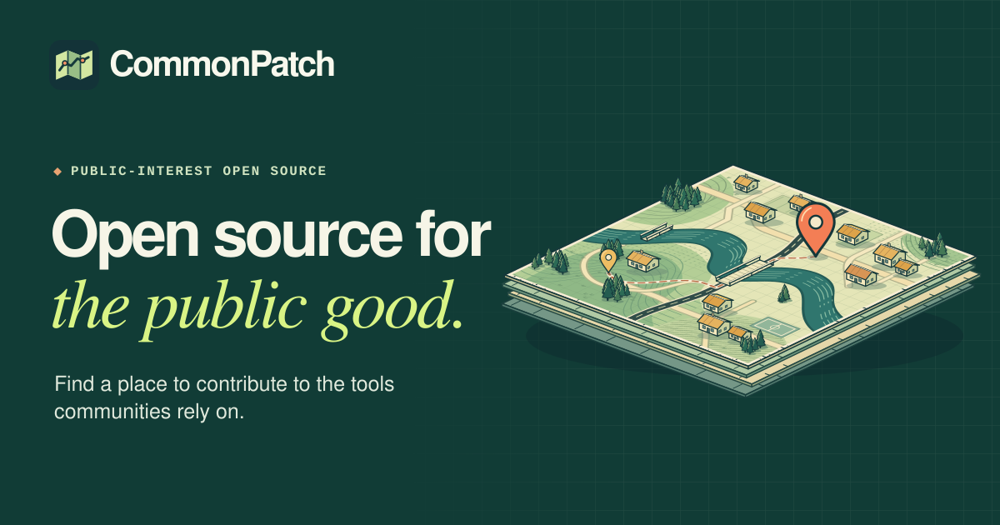

# CommonPatch

A contribution desk for people who want to work on public-interest open source. Find maintained projects by cause, inspect an issue and its linked work, prepare a first contribution, or organize a small group session.

[Open CommonPatch](https://commonpatch.vercel.app/)



## Try it

1. Browse the **Opportunity board** by cause, repository language, or maintainer label. Search matches issue titles, project names, repositories, and labels. A mix of causes is shown by default.
2. Open an issue. Check its original GitHub discussion, assignment status, contributing guide, and linked pull requests before doing substantial work. Reading the bounded timeline helps identify work already underway.
3. Use the preparation checklist and write a private note. Save issues to the **Workbench**. Copy a first-comment draft and decide what to post yourself.
4. Share a shortlist or build a **patch session**. A facilitator can download a calendar file and a Markdown handout. Only public issue references go into a collection link.

## Run locally

Requires Node.js 22 or later. No accounts, API keys, package installation, or database setup are needed.

```sh
npm start
```

Open http://localhost:3000. For a different port use `npm start -- --port 8080`.

```sh
npm test
```

## How it works

The frontend uses native ES modules, semantic HTML, native dialogs, and CSS. Two Node.js serverless endpoints mediate access to GitHub. They share an allowlisted project registry, deadlines, in-flight request deduplication, cache rules, and anonymous API rate-limit handling.

| Endpoint | Purpose |
| --- | --- |
| `GET /api/board` | Retrieves and deduplicates open, unlocked, unassigned issues carrying a supported maintainer label. Returns project metadata, a check time, and explicit freshness/partial-result status. |
| `GET /api/issue?repo=owner/name&number=N` | Reads an allowlisted issue, including current state, description, and bounded timeline context when available. |
| `public/data/board.json` | A dated, manually checked fallback for slow or unavailable upstream requests. |
| `public/data/projects.json` | Public project descriptions, official contribution guides, project languages, and explicit invitation labels. |

The public board uses a bounded search window. Counts describe the indexed results. GitHub is authoritative for current state. A project’s primary language does not establish which skills a particular issue requires. Maintainer labels do not establish effort or guarantee an issue is free to claim.

## Privacy

Bookmarks, notes, and checklists stay in this browser profile. Clearing site storage removes them. A collection URL contains public issue references. The app does not send comments, publish notes, invite participants, or request access to a GitHub account. Calendar and Markdown files are created on the device.

## Community

Suggest a public-interest project using the repository’s **Suggest a project** issue form, or submit a change to the catalog. Read [how the board is curated](CURATION.md) and [the product and interaction brief](DESIGN.md).

CommonPatch is an independent community project by Adithya S. The MIT license applies to the CommonPatch code and original artwork. Upstream project names, issue text, and materials remain with their respective owners.
